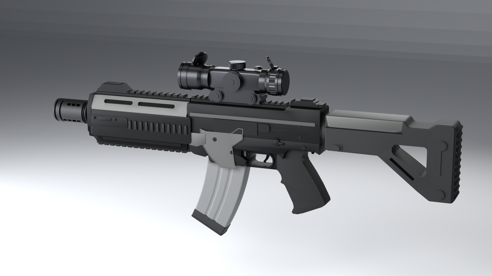
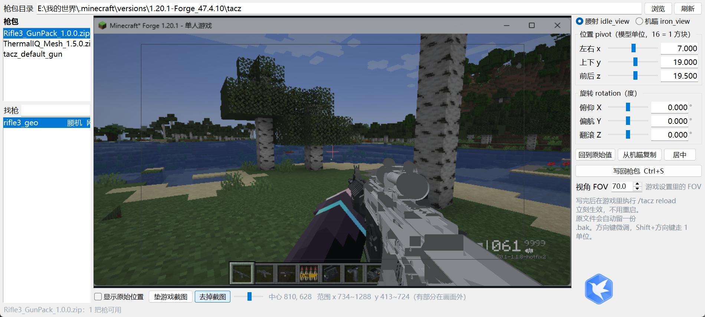
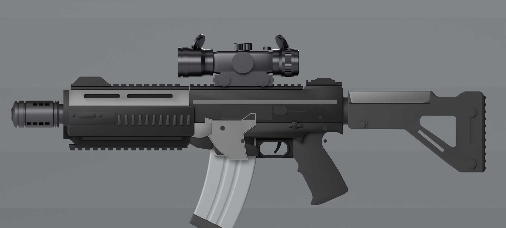
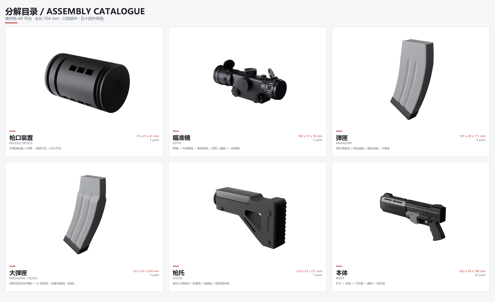

# AI 全流程 Minecraft TaCZ 枪包 · R3 Carbine

这是一个**能直接装进游戏用的 TaCZ 枪包**。从零到成品——建模、绑骨、动画、配件、弹药、打包——全部由 AI（`deepseek-v4.1-flash-1017`）在 DeepSeek Harness 里完成，人只提需求、看结果、做验收。

**游戏内实测：可用，无恶性 bug。**

> ### [⬇ 直接下载枪包 R3 Carbine v1.0.0](https://github.com/miku3928/ai-tacz-gunpack/releases/latest/download/Rifle3_GunPack_1.0.0.zip)
> 一个 zip，下载完丢进 `<实例>/tacz/` 重启游戏就能玩。不想下整个仓库的，只要这一个文件。



---

## 直接开玩

**需要**：Minecraft 1.20.1 + Forge 47.4.10 + TaCZ `1.1.8-hotfix2` + **TML**（`tacz-mesh-loader-forge-1.20.1-0.1.8`，poly_mesh 格式必需）。

1. **[下载 Rifle3_GunPack_1.0.0.zip](https://github.com/miku3928/ai-tacz-gunpack/releases/latest/download/Rifle3_GunPack_1.0.0.zip)**（1.2 MB）
2. 丢进 `<实例>/tacz/` 目录
3. **重启游戏**（换包必须重启，`/tacz reload` 对 gun index 不一定够）
4. 创造模式物品栏的 TaCZ 页签里找 **R3 Carbine / R3 卡宾枪**

> 只想要弹药、不要枪的话，[单独下 7x46 弹药包](https://github.com/miku3928/ai-tacz-gunpack/releases/latest/download/7x46_GunPack_1.0.0.zip)。
> 已经装过枪的话不用管它——7x46 已经包含在上面那个包里了。

枪吃 **7×46 mm** 实验弹（随包附带，枪械工作台可合成：铜锭 15 + 火药 4 + 青金石 4 → 40 发）。

| 项 | 数字 |
|---|---|
| 全长 | 704 mm |
| 模型 | 111 506 三角面（poly_mesh，零精度损失）/ 45 骨骼 |
| 动画 | 9 个（含换弹、空仓挂机、开镜、检视） |
| 配件 | 4 个自带（枪口 / 瞄具 / 枪托 / 扩容弹匣）+ 兼容官方 6 类 |
| 弹药 | 7×46 mm，30 发匣，扩容 60/75/90 |
| 离线自检 | 0 error / 0 warning |

---

## 它同时是一份 AI 能力的记录

下面这些内容是**顺带留下的证据**，不是玩这个包的前提。如果你只想玩枪，读到这里就可以去装包了。

TaCZ 没有公开的模型格式文档，而一个枪包出错的方式几乎全是**静默失败**：

| 你写错了什么 | 游戏的反应 |
|---|---|
| `format_version` 写成 `1.21.0`（而非 `1.10.0` / `1.12.0`） | 骨骼解析失败，什么都不发生 |
| `model_type` 写成 `meshy`（日志里就是这么写的） | 模型完全不加载，无报错 |
| poly_mesh 角点顺序不是 `[位置, 法线, UV]` | 贴图噪点，或直接 `ArrayIndexOutOfBoundsException` |
| `extended_mag_ammo_amount` 写成 1 项（要求正好 3 项） | Gson 异常 → **整把枪从索引里消失**，物品退化成紫黑格 |
| 自带瞄具挂在 `scope_default` 上 | 不报错，只是永远可见 → 装上瞄具后**两个镜子叠在一起** |
| 多边形的面绕序反了 | Blender 里看不出来，进游戏是**黑面** |

没有一行日志告诉你哪里错了。这套做成，靠的是四件事：

1. **把机器当证据用。** 所有关于 TaCZ 内部行为的结论都来自 jar 的**字节码常量池**（本机没有 JDK、没有 javap、没有外网、没有 wiki）。
2. **自己造裁判。** `tools/checker/tacz_check.py` 能对任意 TaCZ 枪包跑全套离线检查；`tools/fpv_tuner/` 用逐字节核对过的矩阵复现游戏内投影，拖滑块调第一人称位置，写回枪包后 `/tacz reload` 即生效。
3. **把「看起来对」换成数字。** 第一人称位置、镜孔黑边比例、附件挂点，全部与官方 112 把枪做语料统计标定之后才落地（见 `docs/踩坑与解法.md` 的 P4）。
4. **结论落到文档里，而不是烂在会话里。** `docs/` 三份：玩家验收、开发者交接、方法论。

### 顺手做出来的工具：第一人称定位调参器

改第一人称枪的位置，原本只能开 Blockbench、装 cameras 插件、把 FOV 设成 70、对着屏幕猜，改一次重启一次游戏。这个工具把那条路砍成：选枪 → 拖 → 写回 → `/tacz reload`。

> ### [⬇ 下载调参器 TaCZ First Person Tuner v1.0](https://github.com/miku3928/ai-tacz-gunpack/releases/download/v1.0.0/TaCZ_FirstPerson_Tuner_v1.0.zip)
> 解压双击 exe，**不需要装 Python**。源码在 [`tools/fpv_tuner/`](tools/fpv_tuner/)。



它不只对 R3 有用，**任何** TaCZ 枪包都能调 —— 官方包、别人的包、你自己在做的包。支持 cube 和 poly_mesh（TML）两种模型，目录形态和 zip 形态的枪包都能读写。

预览用的矩阵不是拟合的：

```
P = Rz(180°) · inv(W)
```

从 `GunItemRendererWrapper.renderFirstPerson` 逐行推出来，再用「照抄字节码」的写法反向核对，六把官方枪的最大误差 **1.9e-16**。所以预览里看到的位置就是游戏里的位置。

顺带纠正一个流传很广的说法：**枪的第一人称渲染不经过原版 `ItemInHandRenderer`**。TaCZ 自己的 `FirstPersonRenderEvent` 里 `@SubscribeEvent` 被注释掉了，实际是内嵌库 simplebedrockmodel 的 `FirstPersonRenderHandler` 接管 `RenderHandEvent` 并 cancel 掉原版渲染。从「原版会拉远、往下、往右」去推偏移，方向从一开始就是错的。

### 做到的

**换弹动画照抄官方 m4a1。** 把官方 `m4a1.animation.json` 的骨架、节奏、音效节拍逐通道对齐，再换成自己的几何。左手**真的抓着弹匣一起走**（弹匣挂在手骨子树下，`lefthand` 的 position 通道叠了弹匣位移），不是「原力换弹」。空仓换弹最后会拉一下枪机。

**抛壳口是真开孔。** 上机匣右侧有一个 70×18 mm 的窗口，透过它能看到枪机。最初是错的——布尔切完之后装饰板的内层盖还留在窗口中间，渲染图和游戏里都只看到浅坑。最后**用射线打过去**才发现：窗口里先打到的是 `UR_detail @ y −24.6`，而不是 `Bolt @ −18.5`。

**配件改装界面是横着的。** 最初枪在配件界面里竖着怼镜头。根因不在布局代码，而在 `refit_view` 这根骨**只写了 pivot 没写 rotation**——TaCZ 用 `getPositioningNodeInverse()` 反解这条骨链摆枪，官方 490 把枪的 `refit_view` 全是 `[0,90,0]`。

**自带瞄具不会和配件叠成两个镜子。** TaCZ 的 `allAttachmentRender()` 明确**跳过** `SCOPE` 类型（`type != NONE && type != SCOPE`），所以 `scope_default` 这根骨永远不会被隐藏。改挂到 `sight`（有 `scopeHiddenRender` 接管）之后，装镜即隐藏。

**开火时手臂不翻飞。** `shoot` 是**叠加（additive）**动画，值会加到 `static_idle` 上。之前在里面也写了手部姿态 96°，叠加后变成 192°。现在 `shoot` 里只有 root / 枪机 / 扳机。

### 局限

- **没有手部模型。** 第一人称的手是 TaCZ 用原版玩家手臂画的，本包只提供 `righthand_pos` / `lefthand_pos` 的位置与握姿旋转。
- **依赖 TML。** poly_mesh 格式原版 TaCZ 不认。
- **官方配件位置对、比例未必协调。** 官方配件按 m4a1 的挂点设计，本枪比 m4a1 短一截。
- **包的整体质量随 AI 能力波动。** 这一版做到了可用无恶性 bug，不等于每一版都能。

---

## 仓库里有什么

```
dist/                       成品枪包（直接丢进 .minecraft/tacz/）
blender/                    Blender 源工程 + 29 个 r3_*.py（建模 / 绑骨 / 导出 / 动画 / 打包）
  rifle3.blend              程序化建模的源 .blend（几何由脚本生成，不手改）
  r3_lib.py r3_parts.py     几何库与 11 个部件的尺寸常量（唯一真相来源）
  r3_export_tacz.py         blend -> poly_mesh geo.json（镜像 / 绕序 / n-gon 三角化都在这）
  r3_anim.py                稀疏关键帧 -> 1/30 s 烘焙的 .animation.json
  r3_pack.py                散文件 -> zip
tools/checker/tacz_check.py  离线校验器，对任意 TaCZ 枪包可跑
tools/fpv_tuner/             第一人称定位调参器（带界面，拖拽/写回/垫截图，支持 cube 与 poly_mesh）
ammo/7x46/                   架空 7×46 mm 弹药的完整素材与生成脚本
docs/枪包说明.md             玩家向：安装、进游戏怎么找、10 条验收清单
docs/交接文档_枪包开发.md     开发者向：环境、重建链、字段、状态机、字节码取证方法
docs/踩坑与解法.md           方法论：8 个模式，每个都带识别信号 / 机制 / 处理 / 代价
```

### 截图

| 侧视 | 分组建模 |
|---|---|
|  |  |

---

## 想改它 / 想再做一把

先读 `docs/踩坑与解法.md`。它不讲代码，讲**为什么**：

- **P1 沉默系统**：这类系统把异常降解成「没有效果」，所以你必须有自带裁判。
- **P2 数据驱动的引擎把名字当 API**：骨骼名 / 系统保留名 / tag 名 / 类型名是四种东西，写错不报错。
- **P3 语义先于数值**：替换 vs 叠加、父子 vs 兄弟、绝对 vs 增量——先答语义再调数字。
- **P4 判据必须在真实语料上标定**：官方自己也大量出框，所以「出框」不是失败判据。

重建链（只有第 1 步需要 Blender；2–5 是纯 Python，全程 < 6 秒）：

```bash
cd blender
blender -b rifle3.blend --python r3_export_tacz.py   # 几何 -> geo.json
python r3_att_geo.py                                  # 附件几何（重定原点到挂点）
python r3_anim.py                                     # 动画烘焙
python r3_pack.py                                     # 打包成 zip
python ../tools/checker/tacz_check.py ../dist/Rifle3_GunPack_1.0.0.zip
```

离线自检可以直接跑（不需要游戏）：

```bash
python tools/checker/tacz_check.py dist/Rifle3_GunPack_1.0.0.zip
# -> Rifle3_GunPack_1.0.0.zip   0 error(s), 0 warning(s)
```

---

## 许可

代码与文档：MIT。模型与贴图：CC BY 4.0。
Minecraft 是 Mojang 的商标，本仓库与其无关；TaCZ 由其作者所有。
